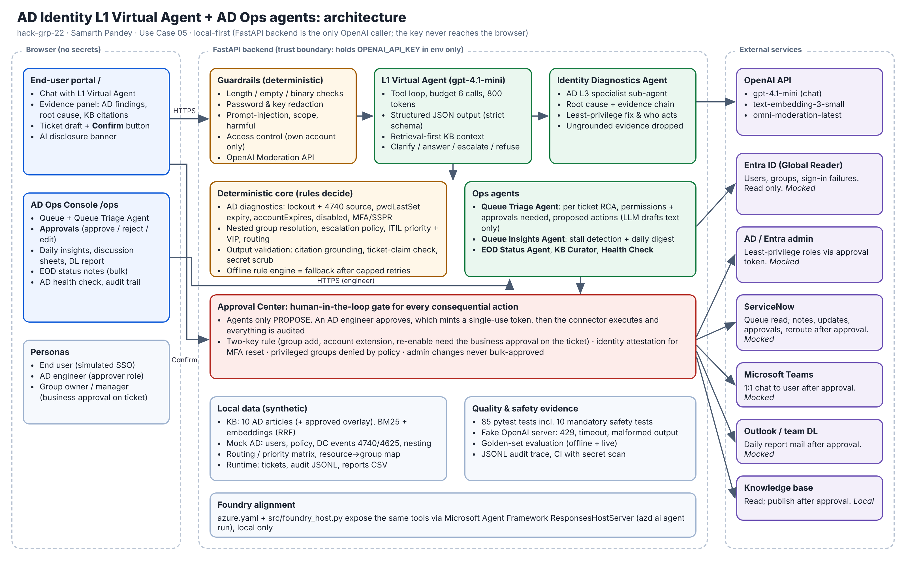

# Architecture: AD Identity L1 Virtual Agent + AD Ops Agents

*hack-grp-22 · Samarth Pandey · Use Case 05*

## Components and how they connect

| Layer | Component | Technology | Responsibility |
|---|---|---|---|
| UI | End-user portal `/`, AD Ops Console `/ops` | Static HTML/CSS/JS (no framework, strict CSP, textContent rendering) | Chat, evidence panel, ticket Confirm; queue, approvals, insights, health, audit |
| API | `src/l1agent/api.py` | FastAPI + Uvicorn | Only component that calls OpenAI; RBAC (end user vs AD engineer), per-user rate limit, security headers |
| Orchestration | `agent.py` (end user), `ops.py` (resolver side) | Python | Guardrails → retrieval → agent loop → validation → audit |
| Agents | L1 Virtual Agent, Identity Diagnostics Agent, Queue Triage Agent, Queue Insights Agent, EOD Status Agent, KB Curator | OpenAI Chat Completions with tools + strict JSON schema | Reasoning and drafting over verified evidence |
| Deterministic core | `diagnostics.py`, `tickets.py`, `offline.py`, `guardrails.py`, `ops_reports.py` | Python | AD checks, escalation policy, priority/routing, stall detection, health check, fallback engine |
| Retrieval | `kb.py` | BM25 + `text-embedding-3-small`, Reciprocal Rank Fusion; disk-cached vectors | Section-level KB citations (`KB-AD-001#s3`) |
| Human gate | `approvals.py` | Python | Proposals → engineer approval → single-use token → connector → audit |
| Connectors | `connectors.py`, `ops_reports.MailConnector` | Mocks shaped like Graph / ServiceNow Table API | Entra Global Reader (read-only), ControlledAdmin, ServiceNow, Teams, Outlook DL, KB writer |
| Foundry | `azure.yaml`, `src/foundry_host.py` | Microsoft Agent Framework `ResponsesHostServer` | Same tools exposed as a Foundry hosted agent, run locally |

## Agent workflow

**End-user turn**
1. Guardrails: empty/oversized/binary rejected; passwords and keys redacted; prompt-injection, harmful (credential dumping, MFA bypass), out-of-scope (HR) and other-user requests refused; OpenAI Moderation API.
2. Retrieval-first: the top KB sections for the message are retrieved and given to the model as `<kb_context>`. Access questions also get a deterministic group check.
3. The L1 Virtual Agent (at most 6 tool calls) calls `consult_identity_diagnostics`. That runs the deterministic AD checks and DC-event correlation, then the **Identity Diagnostics Agent** writes the root cause, evidence chain and least-privilege fix. The L1 agent may also call `search_kb`, `check_group_access` and `draft_ticket`.
4. Validation: citations must have been retrieved this turn (article-level citations are normalised, others removed); steps without valid citations are removed; the **deterministic escalation policy** forces a ticket draft for privileged cases (repeated lockouts, expired or disabled account, non-member access, lost MFA device, broken domain trust); invented ticket IDs and "I submitted a ticket" claims are corrected; secrets and system-prompt text are scrubbed.
5. The reply (answer, clarify, escalate or refuse) is returned with its evidence. The ticket is created only by the user's **Confirm** (POST `/api/tickets/{draft}/confirm`, owner-checked).

**AD queue ticket (Ops Console)**
1. The Queue Triage Agent reads the ticket (ServiceNow), the caller (Entra Global Reader), AD diagnostics, DC events and the KB.
2. Rules decide the root cause, the least-privilege role, the business approval needed, and the allowed actions (work note, Teams message, approval request/reminder, reroute, admin change, KB update).
3. The LLM drafts the summary, work note and Teams message from that evidence. The output is validated, for example it must never ask for a password.
4. Each action becomes an Approval Center item. An engineer approves it (optionally editing the text). Admin changes also need the business approval on the ticket (two-key rule), and MFA reset or re-enable need an identity-verification attestation. Privileged groups are denied by policy.
5. Routines: Queue Insights digest, daily/weekly CSV sheets, DL report mail, EOD notes (bulk-approvable; admin changes never are), health check.

## OpenAI models and tools

| Use | Model | Settings |
|---|---|---|
| L1 Virtual Agent, Identity Diagnostics, Triage narrative, Insights digest | `gpt-4.1-mini` (`OPENAI_MODEL`) | temperature 0.2, `max_completion_tokens` 500 to 900, strict `json_schema`, `parallel_tool_calls=false` |
| Hybrid KB retrieval | `text-embedding-3-small` | 30 to 40 KB sections embedded once, cached by content hash |
| Input screening | `omni-moderation-latest` | Fails open to the local guardrails (flagged in the trace) |

Reliability: the SDK's retries are disabled; our own retries on 429/timeout/5xx use exponential backoff with full jitter, capped at 3 attempts, then the turn falls back to the offline rule engine with a visible banner. Cost control covers the tool budget, token caps, a repeat-message cache, a 20-turn conversation cap and 15 chat requests per user per minute.

## External services

| Service | Status in this package | Production equivalent |
|---|---|---|
| OpenAI API | **Real** (key from `.env`, server side only) | Same, or Azure OpenAI in Foundry with Key Vault |
| Entra ID / AD (read) | Mock: synthetic `directory.json`, `security_events.json` | Microsoft Graph with the Global Reader role; DC security log via Sentinel/Log Analytics |
| AD / Entra admin | Mock `ControlledAdmin` (approval token required) | PIM-activated service principal with Helpdesk / Authentication / Groups / User Administrator scoped by administrative unit |
| ServiceNow | Mock queue `servicenow_queue.json` | Table API (`incident`, `sysapproval_approver`) via an integration user |
| Microsoft Teams / Outlook | Mock outboxes | Graph `chatMessage` / `sendMail` |
| Knowledge base | Local Markdown plus approved overlay | ServiceNow KB / SharePoint |
